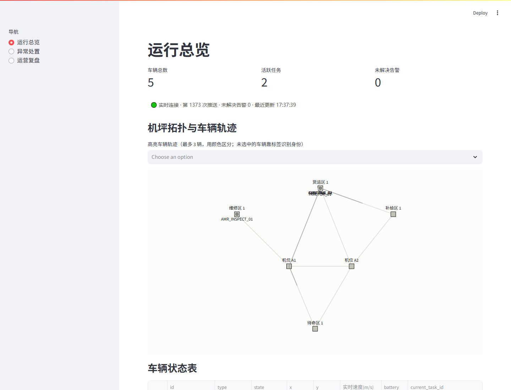
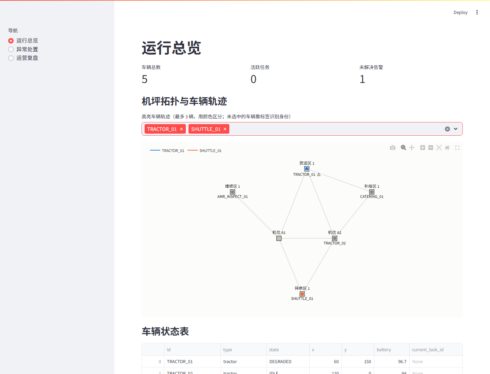
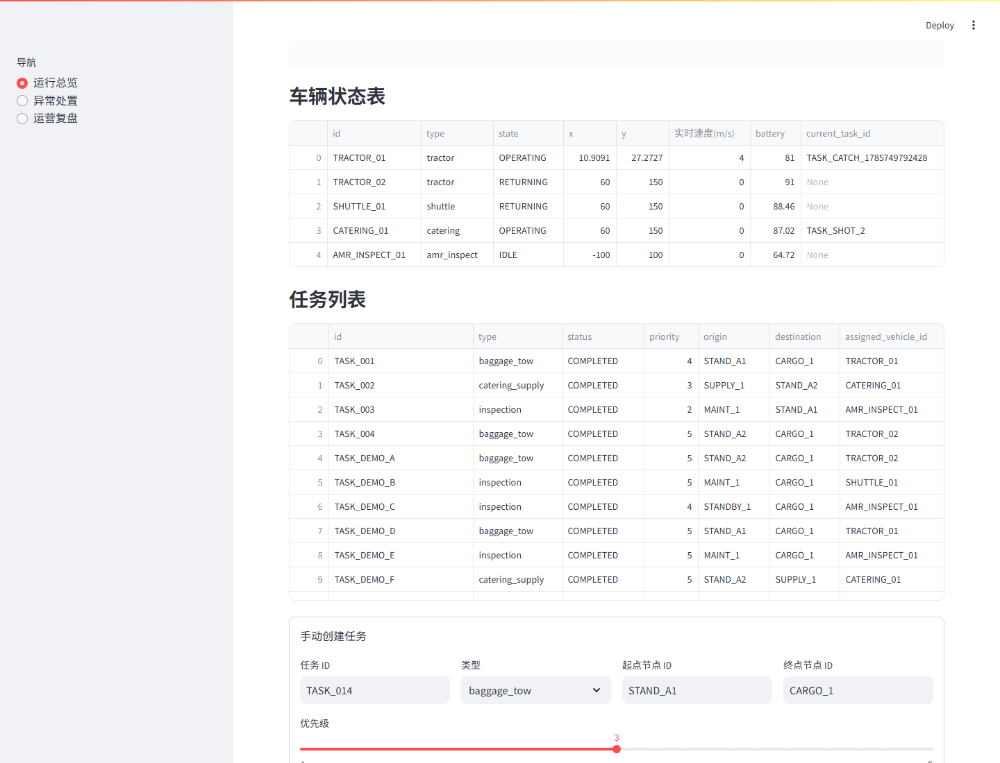
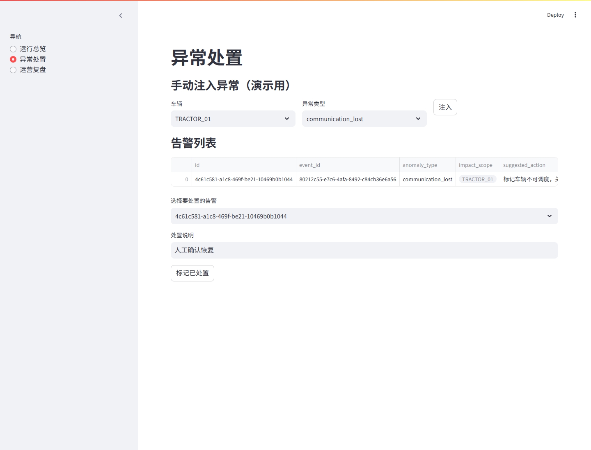
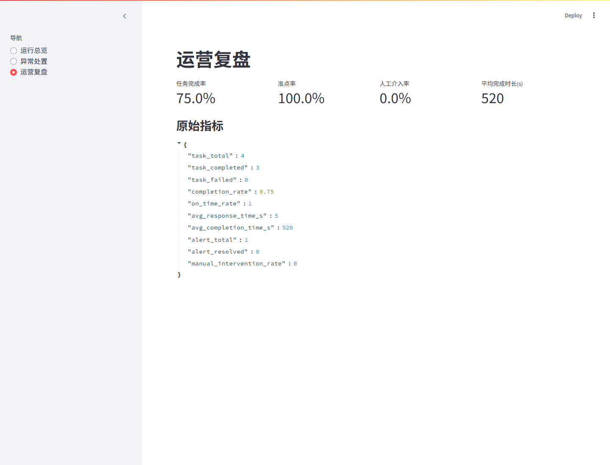

# ApronOps 使用说明书

> 本说明书面向"第一次接触这个项目、想搞清楚它到底是什么、能干什么"的读者，配有真实运行截图。所有截图均来自本地实际启动的系统，不是设计稿。

## 1. 一句话说清楚它是什么

ApronOps 模拟的是**机场机坪上一群自动驾驶保障车辆（牵引车、摆渡车、配餐车、巡检 AMR）如何被自动调度去干活，以及出故障时系统怎么发现并交给人处置**。

现实中的对应场景：飞机落地后，需要牵引车拖行李、配餐车送餐、巡检车检查机位——这些车以后会越来越自动驾驶化。ApronOps 不是控制真实车辆，而是**用代码模拟这一整套"任务产生 → 调度分车 → 车辆移动执行 → 异常检测 → 人工介入 → 效果复盘"的闭环**，是一个可以跑起来、可以点、可以看数据变化的沙盘。

它存在的意义（对应你简历上两条叙事）：
- **自动驾驶叙事**：调度器（`scheduler.py`）是"车队大脑"的简化版——怎么把任务派给最合适的车，怎么在车辆异常时重新分配任务，是自动驾驶车队运营系统的核心问题之一。
- **具身智能叙事**：车辆有位置、有状态机、会在拓扑图上真实移动、会因为电量/通信/定位问题进入异常态——这是"感知-决策-执行-异常恢复"闭环的最小可运行版本。

## 2. 系统由什么组成（跑起来是什么样）

```
浏览器（Streamlit 看板，8501 端口）
        │  HTTP 请求               ▲
        ▼                          │ WebSocket 推送（/ws/state）
FastAPI 后端（8000 端口）──── 后台线程每 2 秒 tick 一次仿真
        │
        ▼
内存中的 World（车辆/任务/告警/拓扑/轨迹）── 写入 SQLite
```

- 后端每 2 秒自动推进一次仿真时间（车辆往前挪一段路、任务进度推进、异常规则检查一遍），不需要人操作，它自己在"活"。
- 看板对后端状态的获取以 HTTP 拉取为主：你在浏览器里看到的拓扑图、车辆状态表、任务列表，都是页面重跑时重新问了一次后端"现在什么情况"，不会自己变。
- 唯一的例外是"运行总览"页顶部那一行连接状态文字（🟢 实时连接 · 第 N 次推送 · ……）：它通过一条独立的 WebSocket 通道（`/ws/state`）接收后端每次 tick 后主动推送的轻量状态帧，用原生 JS 直接改这一行文字，**不刷新整页、不经过 Streamlit 重跑**——这是"后端主动推给你"而不是"你不停问后端"的证据。它目前只负责这一行文字，不会带动 Plotly 拓扑图或下面的表格跟着实时刷新，这一点在第 7 节"已知边界"里会如实说明。

启动命令（本机已验证过）：
```
# 后端
.\.venv\Scripts\python.exe -m uvicorn apronops.api.main:app --host 127.0.0.1 --port 8000

# 看板
.\.venv\Scripts\python.exe -m streamlit run apronops/dashboard/app.py --server.port 8501
```
打开 `http://127.0.0.1:8501` 即可看到下面这些页面。

## 3. 页面一：运行总览 —— "现在机坪上发生了什么"



这是打开看板看到的第一页，一眼能看到三类信息：

1. **顶部三个数字**：车辆总数（5）、活跃任务数（此刻有几个任务正在执行中）、未解决告警数。
2. **实时连接状态行**（本轮新加）：`🟢 实时连接 · 第 N 次推送 · 未解决告警 X · 最近更新 HH:MM:SS`——这一行文字不需要你刷新页面就会持续跳动，因为它是后端通过 WebSocket 每次 tick 主动推给浏览器的（见第 2 节），是整个看板里唯一"自己会动"的部分；连接断开时会变成 `🔴 连接断开`。
3. **机坪拓扑与车辆轨迹图**：
   - 图上的方块节点是机坪上的作业点：机位 A1/A2、货运区、维修区、补给区、待命区，节点之间的连线是它们之间的通行路径——这就是"机场拓扑"。
   - 每个节点旁边的文字（如 `TRACTOR_01`）是当前停在那里的车辆 id，身份靠文字标签识别，不靠颜色（下面会解释为什么）。
   - 车辆异常时（比如 `DEGRADED` 降级态）marker 会切换成**三角形+⚠ 警示符号**，图上不用改变整体配色就能一眼看出"这台车不对劲"。
   - 把鼠标停在某个车辆 marker 上，hover 提示里能看到该车当前的**实时速度**——车辆不再是瞬间跳到目的地，而是有加减速过程，停车让行时速度会先降到 0（详见 3.2 节）。
4. **车辆状态表**：拓扑图的数据兜底视图，逐行看车辆的类型、状态、坐标、电量、当前任务；新增了**"实时速度(m/s)"**一列，跟拓扑图 hover 显示的是同一个数据源，方便在不悬停图表的情况下直接核对所有车辆的瞬时速度。
5. 往下滚动还有**任务列表**和**手动创建任务**的表单（本页截图未展示，可自行滚动查看）——你可以在这里手工提交一个新任务，看调度器把它分给哪辆车。

### 3.1 车辆轨迹高亮——认识"选中对比"功能

默认所有车辆轨迹都是灰色半透明的（避免 5 条轨迹互相打架看不清是谁），如果你想重点盯着某几辆车，可以用图表上方的下拉框选中，最多 3 辆：



选中 `TRACTOR_01`（蓝色）和 `SHUTTLE_01`（橙色）之后：
- 这两辆车的轨迹和当前位置变成了对应的高亮色，其他车仍是灰色。
- 图上方出现了图例，标明哪个颜色对应哪辆车。
- `TRACTOR_01` 的 marker 是**三角形**（因为它异常），`SHUTTLE_01` 是**圆形**（正常）——符号形状始终代表"是否异常"，颜色只代表"你有没有选中它"，两个维度不会互相干扰。

**为什么不干脆给 5 辆车分别配 5 种颜色？** 因为车辆在同一个坐标系里自由移动，任何两辆车的轨迹随时可能在图上相邻甚至重合——这种"谁跟谁都可能挨在一起"的场景下，如果颜色太多，色弱/色盲用户以及正常视力用户在轨迹密集处都分不清是哪辆车。所以默认灰色+文字标签兜底，颜色只做"你主动选的最多 3 个重点对象"的强调，这是经过配色规范核查后的设计取舍，不是偷懒。

### 3.2 车辆的加减速与局部避障——"车不是瞬移的"

早期版本里车辆是恒速瞬间挪动的，本轮把这一层换成了更接近真实车辆的连续运动模型：



上图截取自车辆状态表：`TRACTOR_01` 正在执行任务、处于行驶途中，"实时速度(m/s)"一列显示的是 `4.00`（该车型的最高速度），而不是一个跳变的坐标点。具体规则：

1. **有加减速上限**：车辆从静止起步会逐步加速到本车型的最高速度，接近终点或需要减速时也是逐步降速，不会瞬间从最高速跳到 0 或反过来。
2. **同向跟车避让**：如果前方同一条路径上有别的车（包括已经停在终点等待作业的车），后车会根据"当前速度能否安全刹停"实时调整自己的速度上限，逐渐减速直到与前车保持安全净空，不会穿模超车。
3. **对头让行**：如果两辆车在同一条边上迎面相遇，规则很简单且不需要加锁——车辆 id 字典序较大的一方减速直至停车让行，另一方保持正常通行；净空恢复后让行的一方再重新加速通过。这在本轮开发中已经用两台真实车辆（`SHUTTLE_01` 让行、`AMR_INSPECT_01` 通过）跑通验证过。
4. **转弯/进站减速**：车辆临近拐弯较大的节点时会先降到一个较低的限速再通过，不会以直线巡航速度贴着拐角冲过去。

这套避障是**局部、反应式**的——每辆车只感知自己所在这条边上的其他车辆，不做全局路径规划或多车协同优化（比如提前算好所有车的时间窗互不冲突）。这是本轮明确的取舍，第 7 节"已知边界"里也会如实说明。

## 4. 页面二：异常处置 —— "车坏了，人怎么介入"



这一页对应"自动化系统检测到问题后，人在回路里做什么"：

1. **手动注入异常（演示用）**：现实中异常是系统自动检测出来的（通信丢失、定位质量下降、路线阻塞），但为了让你能随时演示/测试这个闭环，页面提供了一个手动触发入口——选一辆车、选一种异常类型、点"注入"，下一次仿真 tick（最多 2 秒后）就会生效。截图里刚给 `TRACTOR_01` 注入了一次 `communication_lost`（通信丢失）。
2. **告警列表**：注入生效后，系统自动生成了一条告警，可以看到 `anomaly_type`（异常类型）、`impact_scope`（受影响车辆）、`suggested_action`（系统建议的处置动作，如"标记车辆不可调度，……"）——这一步体现的是"异常检测 → 自动生成处置建议"，而不是简单报个错完事。
3. **人工处置**：下拉选中这条告警，填写处置说明（比如"人工确认恢复"），点"标记已处置"，就完成了一次完整的"发现问题—人工确认—关闭告警"闭环。

这一页存在的意义：真实的自动驾驶/机器人系统不可能 100% 自动化，"异常发生后系统怎么把控制权和信息清晰地交给人"本身就是一个核心设计问题，这页就是这个交接点的最小实现。

## 5. 页面三：运营复盘 —— "跑了一段时间之后，整体做得怎么样"



如果说前两页是"实时监控"，这一页就是"事后算账"：

- **任务完成率 75.0%**、**准点率 100.0%**、**人工介入率 0.0%**、**平均完成时长 520 秒**——这四个是从蓝图设计里挑出来的核心 KPI，直接反映"这套调度系统跑得好不好"。
- 下面的"原始指标"把计算这些百分比用到的原始计数（任务总数/已完成数/失败数、告警总数/已处置数等）也摊开给你看，避免"黑箱百分比"。

**注意**：这里的人工介入率显示 0.0%，是因为这张截图是在"标记已处置"操作*之前*抓的（告警刚生成、还没处置）；如果你先完成第 4 节的"标记已处置"操作再看这一页，这个数字会变化——这正是"运营总览的操作会实时反映到复盘指标上"的证据，建议你自己动手试一次来验证这个联动关系。

## 6. 建议的一次完整体验路径（自己动手 5 分钟）

1. 打开"运行总览"页，观察车辆在拓扑图上缓慢移动（等 5-10 秒刷新一次页面能看到坐标变化）。
2. 切到"异常处置"页，给任意一辆正常车注入一个异常，等 2 秒，刷新页面，看到告警出现。
3. 切回"运行总览"页，注意刚才那辆车的 marker 变成了三角形+⚠。
4. 回到"异常处置"页，把这条告警标记为已处置。
5. 打开"运营复盘"页，对比"人工介入率"是否从 0% 变化——这就验证了整个闭环确实是联动的，不是三个互相独立的静态页面。

## 7. 目前的已知边界（诚实说明，不是缺陷清单）

这套骨架刻意做了简化，方便快速跑通闭环，主要包括：

- 任务来源是一次性种子数据而非持续生成的任务流。
- 只有一种调度策略在真正生效（另一种"截止时间紧迫度优先"策略代码已写但未接入切换开关）。
- **车辆之间的避障是局部反应式的，不是全局路径优化**：单车层面已经有加减速、同向跟车、对头让行、转弯限速（见 3.2 节），但这只解决"两车碰上了怎么反应"，不解决"提前规划好所有车的路径/时间窗，让它们从一开始就不会碰上"这个更难的多车协同调度问题——这条边界是本轮特意划定的范围，调度层的整体优化留作后续独立课题。
- **看板不是整页自动刷新的**：目前只有"运行总览"页顶部那一行连接状态文字是通过 WebSocket 推送实时更新的（见第 2、3 节），拓扑图、车辆状态表、任务列表这些内容仍然是页面重跑时的快照，需要你手动重新加载页面才能看到最新数据——WebSocket 通道目前特意没有拿来重绘 Plotly 图或表格，因为在前端 JS 里重新实现一遍已经过配色规范校验的图表，改动范围会失控。
- 车辆的跟车/让行速度是按离散子步（每 0.5 秒仿真时间）逼近一个理想目标速度算出来的，不是连续微分方程的精确解，遇到车速/间距突变的极端情况可能有轻微超调，属于已知的简化。
- 轨迹数据只存在内存里，重启即丢失。
- 没有做数据库 schema 迁移工具：如果你修改了 `Vehicle`/`Task` 等模型的字段，需要手动删除本地的 `apronops.db` 让程序重新建表，不会自动迁移旧数据。

这些都是有意为之的取舍，不是本轮要解决的问题——如果你希望针对某一项深入完善（比如做调度策略 A/B 对比的可视化，或者把局部避障升级成多车协同的全局路径规划），可以告诉我优先做哪个，我再单独规划。
